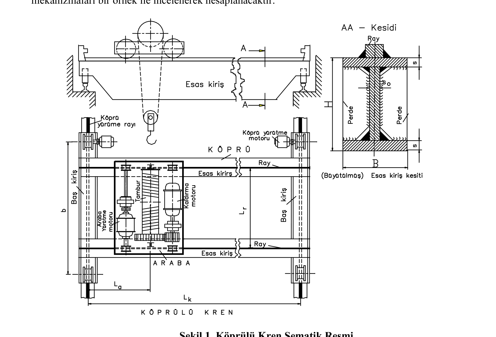
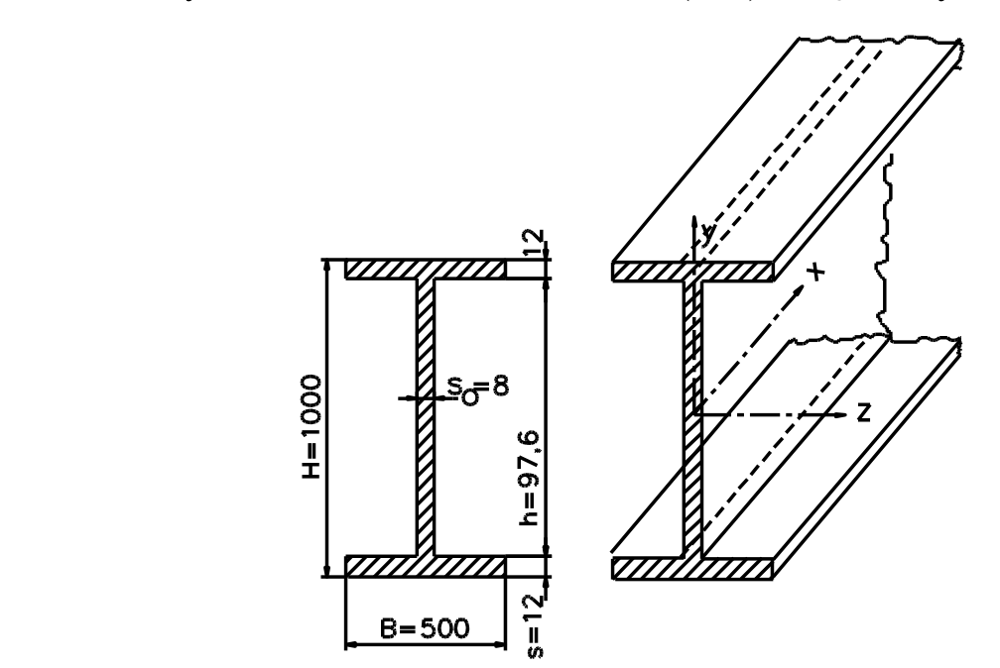
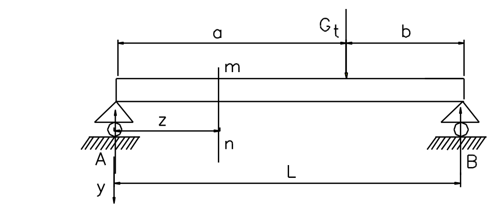
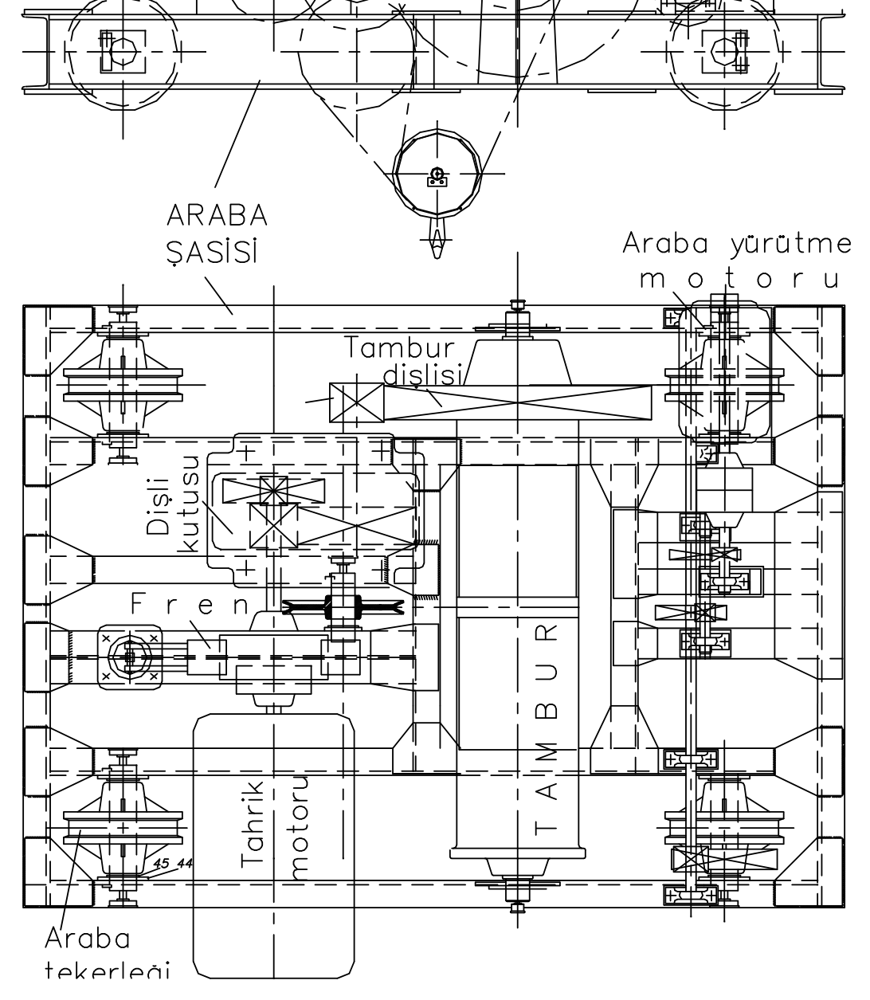
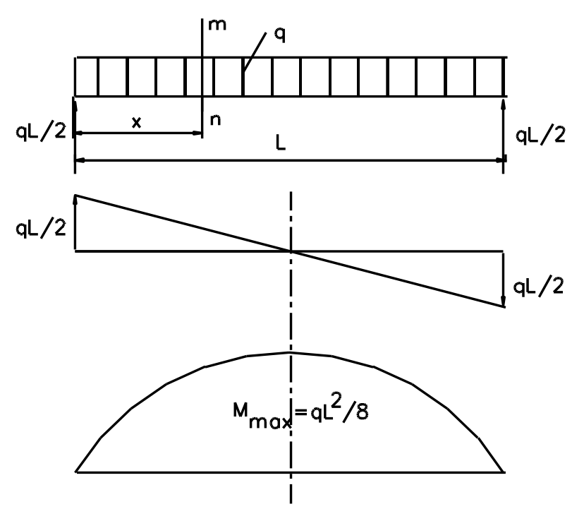
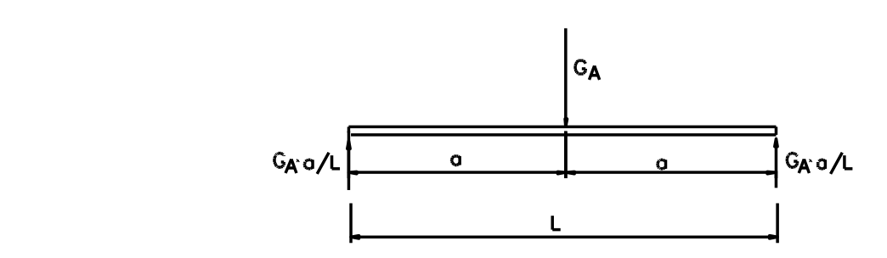
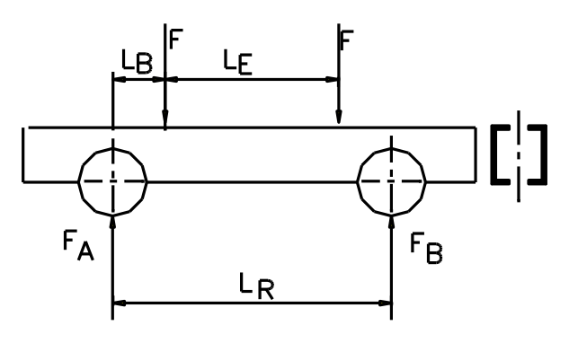

# Gezer Köprülü Kren Hesabı (`gezer_kren_hesabi`)

Bu örnek, **gezer köprülü krenin** (overhead travelling crane) konstrüksiyon ve hesap zincirini
tek dosyalık bir Fortran programına çevirir: araba ve köprü **tekerlek çapları** (DIN 15070),
**yürütme motorları**, esas kirişin **sehim** ve **eğilme gerilmesi** hesabı, **baş kiriş**
boyutlandırması ve her kritik sayı için **çapraz kontrol**.

Örnek veriler kaynak metinden alınmıştır (EK-A2, "Gezer Kren Köprüsü Konstrüksiyonu ve Hesabı"):
`Q_K = 10 000` kg kaldırma yükü, `G_A = 2 800` kg araba, `L_K = 20` m köprü açıklığı, esas kiriş
`400` kg/m, yük sınıfı **H2**, işletme şartı **orta**. Kural aynı: **hiçbir sayı elle yazılmaz**,
her değer dosyadaki bir formülden üretilir; belgenin basılı sayıları yalnız **karşılaştırma**
sütununda yaşar.

> Aynı hesabın **GNU Octave** sürümü kardeş depoda durur:
> [`gezer_kren_hesabi`](https://onkanat.github.io/Octave_TR_Doc/gezer_kren_hesabi.html) — orada
> ek olarak kesit, moment diyagramı ve sehim eğrisi çizilir. İki dilin **sayısal çıktısı 101 satırda
> birebir aynıdır**.

## Amaç ve Kapsam

- **Tekerlek çapı** (DIN 15070): `D = R/(p_em*C2*C3*b)` ve **karakteristik yük** yolu
  `R0 = R/(C1*C2*C3)` — iki yolun aynı standart çapı vermesi beklenir.
- **Yürütme dirençleri**: yürüme `W = n (G/D)(mu d + 2f)` ve ivme `W_iv = n (G/g) a`;
  motor gücü `N = W V/(102 eta)`.
- **Sehim**: `f_top = L^3/(48·E·Iz) · [ (5/8)·G_K + (Q_K+G_A) ] / 2 <= f_em = L/750`;
  buradan gerekli `I_z` ve seçilen kesitin yeterliliği.
- **Gerilme**: `sigma = (phi·M_T + psi·M_K)/W_z + M_AT/W_y <= sigma_em`.
- **Baş kiriş**: `F` yatak kuvveti, `M = F L_B`, profil başına mukavemet momenti.
- **Çapraz kontrol**: her kritik sayıya ikinci (cebirsel) yoldan varma.

Kapsam dışı: kaynak dikişi hesabı, yorulma (H2 için ömür hesabı), halat/kanca mekanizması,
kren yolu (ray) temeli. Bu program **boyutlandırma hesabı** üretir, imalat resmi değil.



*Şekil 1 — Köprülü kren: araba köprü üzerinde, köprü kren yolu boyunca hareket eder; yük üç
doğrultuda taşınır (kaynak belge, Şekil 1).*

## Hesap Zinciri (formüller)

| Büyüklük | Formül | Programdaki fonksiyon |
|---|---|---|
| Basınç emniyeti | `p_em = 56 * C1` | `basinc_emniyeti` |
| Tekerlek çapı | `D = R / (p_em*C2*C3*b)` | `tekerlek_capi` |
| Yürüme direnci | `W = n*(G/D)*(mu*d + 2f)` | `yurume_direnci` |
| İvme direnci | `W_iv = n*(G/g)*a` | `ivme_direnci` |
| Motor gücü | `N = W*V/(102*eta)` | `guc` |
| Kesit atalet momenti | `Iz = B*(H^3-h^3)/12 + s0*h^3/12` | `kesit_ataket_momenti` |
| Gerekli atalet momenti | `Iz = L^3/(48 E f_em) * [5/8 GK + (QK+GA)] / 2` | `gerekli_ataket_momenti` |
| Sehim (kapalı form) | aynı ifade, `Iz` yerine kesit değeri | `sehim_toplam` |
| Sehim (sayısal) | `f = ∫ M(x)*mbar(x)/(E Iz) dx` (Simpson) | `sehim_sayisal` |
| Eğilme momenti | `M(x) = q x (L-x)/2 ± P x/2` | `kesme_momenti` |
| Gerilme | `sigma = (phi*M_T + psi*M_K)/W_z + M_AT/W_y` | ana program |
| Baş kiriş kuvveti | `F = 1/2*[QK*psi*oran + GA*phi*oran + GK*phi/2]` | `bas_kiris_kuvveti` |

Birimler belgedeki gibi: kuvvet **daN**, uzunluk **cm** (köprü açıklığı m), gerilme **daN/cm²**.
Çelik: `E = 2,1e6` daN/cm²; St 37 için `sigma_em = 1600` daN/cm² (160 N/mm²),
St 52-3 için 2400 daN/cm² (DIN 15018). Katsayılar `phi = 1,1` (zati ağırlık),
`psi = 1,3` (H2 yük sınıfı).

## Derleme ve Çalıştırma

```sh
gfortran gezer_kren_hesabi.f90 -o gezer_kren_hesabi
./gezer_kren_hesabi
```

Program **girdi istemez**: örnek veriler `parameter` olarak dosyanın başında durur, çıktı iki
koşuda birebir aynıdır. Başka bir kren için yalnız o sabitleri değiştirmek yeterlidir.

## Beklenen Çıktı

Aşağıdaki blok, `gfortran -Wall -Wextra -pedantic -fcheck=all` ile derlenmiş programın **gerçek
koşusundan** alınmıştır (elle yazılmadı):

```text
========================================================================================
GEZER KOPRULU KREN - KONSTRUKSIYON VE HESAP
Q_K = 10000 daN | G_A = 2800 daN | L_K = 20 m | G_K = 16000 daN | sinif H2
g = 9.81 m/s^2 | E = 2.1e6 daN/cm^2 | sigma_em = 1600 daN/cm^2 (St 37) | phi = 1.1 | psi = 1.3
========================================================================================

[1] Araba tekerlek capi (DIN 15070):  D = R / (p_em * C2 * C3 * b)
 R_A = (Q_K + G_A)/4                        3200.0000 daN
 p_em = 56 * C1   (C1 = 0,63)                 35.2800 daN/cm2
 D_A                                          22.0153 cm
 D_A   (C1 = 0,50 satiri)                     27.7393 cm
 secim: standart cap 250 mm (belge 222 mm yaziyor; formul 220 mm veriyor)
 not: belgedeki C1 = 0,50 satiri kullanilirsa 315 mm gerekir -> 250 mm ile celisir.

[2] Hizlar:  V = D * pi * n
 V_araba (teorik, D*pi*n)                     19.6350 m/min
 V_kopru (teorik, D*pi*n)                     39.2699 m/min
 V_araba (anma, guc hesabi)                   20.0000 m/min
 V_kopru (anma, guc hesabi)                   40.0000 m/min

[3] Kopru tekerlek capi: maksimum kuvvet (araba bas kirise yanasik)
 R_kopru                                   10080.0000 daN
 p_em = 56 * C1   (C1 = 0,80)                 44.8000 daN/cm2
 D_kopru  (gerilme yolu)                      48.5437 cm
 R0 = R / (C1*C2*C3)  (tablo yolu)         12233.0097 daN
 secim: standart cap 500 mm (her iki yol da 500 mm veriyor)

[4] Araba yurutme motoru:  W = n * (Q+G)/D * (mu*d + 2f),  N = W*V/(102*eta)
 W_yurume                                    307.2000 daN
 N_yurume                                      1.1811 kW
 W_ivme                                      391.4373 daN
 N_ivme                                        1.5049 kW
 N_anma = (N_yur+N_iv)/1,7                     1.5800 kW

[5] Kopru yurutme motoru (4 tekerlek uzerindeki toplam yuk)
 Q_toplam                                  28800.0000 daN
 W_yurume                                    566.7840 daN
 N_yurume                                      4.3582 kW
 W_ivme                                     1409.1743 daN
 N_ivme                                       10.8356 kW
 N_anma = (N_yur+N_iv)/1,8                     8.4410 kW
 secim: ayni hizada 2 x 5,5 kW (uzun acikliklarda senkron iki motor)

[6] Sehim: f_top = L^3/(48 E Iz) * [5/8 GK + (QK+GA)]/2  <=  f_em = L/750
 f_em = L/750                                  2.6667 cm
 Iz gerekli (tek kiris)                   339285.7143 cm4
 Iz kesit (Sekil 4)                       354838.5451 cm4
 f_top (secen kesit)                           2.5498 cm
 W_z = Iz/(H/2)                             7096.7709 cm3
 W_y = 2*s*B^2/6                            1000.0000 cm3
 karar: kesit YETERLI (Iz_kesit > Iz_gerekli)

[7] Egilme momentleri (bir esas kiris icin)
 M_I  = GK*L/8                           4000000.0000 daN*cm
 M_II = GA*L/4                           1400000.0000 daN*cm
 M_T  = (M_I + M_II)/2                   2700000.0000 daN*cm
 M_K  = QK*L/(4*2)                       2500000.0000 daN*cm
 a = V_kopru/t_f  (t_f = 4 s)                  0.1667 m/s2
 M_AT                                      88345.2260 daN*cm

[8] Egilme gerilmesi:  sigma = (phi*M_T + psi*M_K)/W_z + M_AT/W_y
 sigma                                       964.8002 daN/cm2
 sigma                                        96.4800 N/mm2
 sigma_em (St 37)                           1600.0000 daN/cm2
 kullanim orani (St 37)                       60.3000 %
 kullanim orani (St 52-3)                     40.2000 %
 karar: sigma <= sigma_em  (St 37 yeterli; St 52-3 de kullanilabilir)

[9] Bas kiris: F, M = F*L_B,  W = M/(2*sigma_em)
 F (yatak kuvveti)                         12038.0000 daN
 L_B = (L_R - L_E)/2                          50.0000 cm
 M = F * L_B                              601900.0000 daN*cm
 W (profil basina)                           188.0938 cm3
 W (belgedeki yazim)                         376.1875 cm3
 secim: belge [260 (Wx = 371 cm3) veya [280 (448 cm3) aliyor -> 2 kat pay
 not: 1/2 carpani uygulanirsa 188 cm3 yeter -> [200 (Wx = 191) de olur.

[10] Capraz kontrol: ayni sayiya ikinci yol
buyukluk                        yol A        yol B   fark %
 f_top  [cm]                   2.5498       2.5498   0.0000
 sigma  [daN/cm2]            964.8002     964.8002   0.0000
 M_T    [daN*cm]         2700000.0000 2700000.0000   0.0000

----------------------------------------------------------------------------------------
Ozet: tekerlek caplari 250/500 mm, motorlar 1,58 kW ve 8,44 kW (secim 2x5,5),
      kesit Iz = 354838 cm4 (gerekli 339286), sigma = 96,5 N/mm2 <= 160 (St 37).

[11] M(x) / V(x) - Sekil 5 karsiligi (zati yayili yuk + ortada tekil yuk)
   x/L    V [daN]  M [daN*cm]  M/M_maks
  0.00   14400.0        0.0 
  0.10   12800.0  2720000.0 ##########
  0.20   11200.0  5120000.0 ####################
  0.30    9600.0  7200000.0 ############################
  0.40    8000.0  8960000.0 ##################################
  0.50       0.0 10400000.0 ########################################
  0.60   -8000.0  8960000.0 ##################################
  0.70   -9600.0  7200000.0 ############################
  0.80  -11200.0  5120000.0 ####################
  0.90  -12800.0  2720000.0 ##########
  1.00  -14400.0        0.0 
 not: yayili yuk q = G_K/L (iki kirisin toplami), tekil yuk (Q_K+G_A) ortada.
```

## Kodun Detaylı Açıklaması

Satır yazımı tek bir yardımcıda toplanır; böylece onlarca değer aynı hizada ve aynı duyarlıkla
basılır (Octave sürümü aynı biçimi `printf` ile kurar, çıktı birebir tutsun diye):

```fortran
subroutine satir(baslik, deger, birim)
  character(len=*), intent(in) :: baslik, birim
  real(real64), intent(in) :: deger
  character(len=38) :: yerel
  yerel = baslik                       ! atama, sağdaki boşlukları doldurur -> sola yaslı etiket
  write (*, '(a,1x,f14.4,1x,a)') yerel, deger, birim
end subroutine satir
```

Tekerlek çapı tek satırlık bir fonksiyondur; DIN 15070'in tüm katsayıları **argüman** olarak
girer, böylece araba (`b = 4,0` cm yassı ray) ve köprü (`b = k-2r = 4,5` cm, A55 rayı) aynı
fonksiyonu kullanır:

```fortran
pure function tekerlek_capi(yuk, p_em, c2, c3, temas_genisligi) result(cap_cm)
  ! D = R / (p_em * C2 * C3 * b)   — b: tekerlek-ray temas genişliği (cm)
  real(real64), intent(in) :: yuk, p_em, c2, c3, temas_genisligi
  real(real64) :: cap_cm
  cap_cm = yuk / (p_em * c2 * c3 * temas_genisligi)
end function tekerlek_capi
```

Tahrik zinciri üç ayrı fiziksel büyüklüktür ve ayrı ayrı raporlanır — yürüme (sürtünme), ivme
(atalet) ve güç (verim). Toplamları **anma gücünü** verirken belgedeki `(1,7 ÷ 2)` bölen
faktörü korunur:

```fortran
pure function yurume_direnci(toplam_yuk, d_tekerlek, mu, d_aks, f_kol, emniyet) result(w)
  ! W = n * (G/D) * (mu*d + 2f)  [daN]
  w = emniyet * (toplam_yuk / d_tekerlek) * (mu * d_aks + 2.0_real64 * f_kol)
end function yurume_direnci

pure function ivme_direnci(toplam_yuk, g, ivme, emniyet) result(w)
  ! W_iv = n * (G/g) * a  [daN]
  w = emniyet * (toplam_yuk / g) * ivme
end function ivme_direnci
```

**Kesit** iki başlık ve bir gövdeden oluşur; atalet momenti paralel eksen teoreminin kapalı
biçimidir (Şekil 4'teki ölçüler):



*Şekil 4 — Esas kiriş kesiti: `B = 500` mm, `H = 1000` mm, başlık `s = 12` mm, gövde `s_0 = 8` mm,
iç yükseklik `h = 976` mm (kaynak belge).*

```fortran
pure function kesit_ataket_momenti(b, h_dis, h_ic, govde) result(iz)
  ! I_z = B*(H^3-h^3)/12 + s0*h^3/12   (Şekil 4: iki başlık + gövde)
  iz = b * (h_dis**3 - h_ic**3) / 12.0_real64 + govde * h_ic**3 / 12.0_real64
end function kesit_ataket_momenti
```

**Sehimin ikinci yolu**: aynı sayı, birim yük yöntemiyle `f = integral M(x)·mbar(x)/(E·Iz) dx`
integralinden Simpson kuralıyla da bulunur. İki yolun aynı sonucu vermesi formülün değil **kodun** doğru
olduğunu gösterir.

```fortran
pure function sehim_sayisal(l, e, iz, g_k, q_k, g_a, adet, adim) result(f)
  ! f = integral M(x)*mbar(x)/(E*Iz) dx  — birim yük yöntemi, Simpson (ikinci yol)
  ...
  f = toplam * h / 3.0_real64 / (e * iz)
end function sehim_sayisal
```



*Şekil 3 — Basit mesnetli esas kiriş: tekil yük `G_t`, açıklık `L`, sehim `f` (kaynak belge).*

### Öne Çıkan Noktalar

1. `implicit none` + `iso_fortran_env :: real64` + `snake_case`: tür ve hassasiyet taşınabilir.
2. Tüm çekirdek fonksiyonlar `pure`; ölçü birimleri **yorumda** yazılı (daN, cm, daN/cm²) — birim
   karışması bu hesabın en kolay tuzağıdır.
3. `[10]` çapraz kontrolü üç satırdır: sehim (kapalı form ↔ integral), gerilme (tek satır ↔
   terim terim), `M_T` (bölünmüş ↔ doğrudan).
4. `[11]` tablosu, belgedeki **Şekil 5**'in sayısal karşılığıdır: `V(x)` ve `M(x)` on bir noktada,
   momentin normalize çubuk grafiğiyle birlikte. Fortran grafik çizemez; ama diyagramın
   **sayılarını** üretir (Octave sürümü aynı veriyi çizer).
5. Program etkileşimsizdir: `read` yok; aynı veri setiyle iki koşu birebir aynı çıktıyı verir.
6. Belgenin yuvarlamaları **gizlenmez**: ara değerler tam duyarlıkla hesaplanır, belgeyle fark
   aşağıdaki karşılaştırma tablosunda açıkça gösterilir.

## Belgedeki Diğer Şekiller



*Şekil 2 — Araba (kaldırma mekanizması, tekerlekler, tahrik): araba ağırlığı `G_A` ve kaldırma
yükü `Q_K` bu 4 tekerlek üzerinden köprü raylarına geçer (kaynak belge).*



*Şekil 5 — Yayılı yük `q`, kesme kuvveti `V(x)` ve eğilme momenti `M_maks = qL^2/8` (kaynak belge).*



*Şekil 6 — Araba ağırlığı tekil yük olarak: mesnet tepkileri `G_A a/L` (kaynak belge).*



*Şekil 7 — Baş kiriş: köprü tekerlekleri arası `L_R = 2,6` m, esas kirişler arası `L_E = 1,6` m,
kol `L_B = (L_R - L_E)/2 = 0,5` m (kaynak belge).*

## Doğrulama ve Belgeyle Karşılaştırma

Program, belgenin basılı sayılarını **yeniden üretir**; farklar yalnız belgenin ara yuvarlamalarından
gelir:

| Büyüklük | Belge | Program | Fark | Neden |
|---|---|---|---|---|
| `R_A` | 3200 daN | 3200,0000 | %0 | — |
| `D_A` | 22,2 cm (222 mm) | 22,0153 cm | −%0,8 | belge 35,3 ile 222 mm yazıyor; formül 220 mm |
| `R_köp` | 10 080 daN | 10 080,0000 | %0 | — |
| `D_köp` | 48,5 cm | 48,5437 cm | +%0,1 | — |
| `R_0` | 12 233 daN | 12 233,0097 | %0 | — |
| `N_yür` (araba) | 1,17 kW | 1,1811 kW | +%0,9 | belge `V = 0,33` m/s yuvarlıyor |
| `N_iv` (araba) | 1,49 kW | 1,5049 kW | +%1,0 | aynı |
| `N_n` (araba) | 1,56 kW | 1,5800 kW | +%1,3 | aynı |
| `N_yür` (köprü) | 4,32 kW | 4,3582 kW | +%0,9 | belge `V = 0,66` m/s |
| `N_iv` (köprü) | 10,72 kW | 10,8356 kW | +%1,1 | aynı |
| `N_n` (köprü) | 8,4 kW | 8,4410 kW | +%0,5 | aynı |
| `f_em` | 2,7 cm | 2,6667 cm | −%1,2 | belge `L/750`'yi 2,7'ye yuvarlıyor |
| `I_z` gerekli | 335 160 cm⁴ | 339 285,7 cm⁴ | +%1,2 | aynı yuvarlama |
| `I_z` kesit | 354 839 cm⁴ | 354 838,5 cm⁴ | %0 | — |
| `W_z` | 7100 cm³ | 7096,8 cm³ | −%0,05 | — |
| `M_T` | `2,7e6` | 2 700 000 | %0 | — |
| `M_K` | `2,5e6` | 2 500 000 | %0 | — |
| `M_AT` | 87 500 daN·cm | 88 345 daN·cm | +%1,0 | belge `a = 0,165` m/s² |
| `sigma` | 963,5 daN/cm² (96,4 N/mm²) | 964,8 (96,5) | +%0,1 | aynı |
| `F` (baş kiriş) | 12 038 daN | 12 038,0000 | %0 | — |
| `M` (baş kiriş) | 601 900 daN·cm | 601 900,0000 | %0 | — |

**Belgede bulunan üç tutarsızlık** (hesabı değiştirmiyor, ama notta yazılı olmalı):

1. **`C_1` çelişkisi (§2.1).** Önce `C_1 = 0,63` ile `p_em = 35,3` daN/cm² alınıp
   `D_A = 22,2` cm bulunuyor; hemen altında "tekerleğe ait değerler `C_1 = 0,50`, `p_em = 28`"
   yazıyor. İkincisi kullanılırsa `D_A = 27,7` cm → standart **315 mm** gerekir; yani belgenin
   **250 mm** seçimi ancak `C_1 = 0,63` satırıyla tutarlıdır. Program iki değeri de basar.
2. **`s` sembolü iki anlamda.** `I_z` formülünde `s = 0,8` cm (gövde), `W_y` formülünde
   `s = 1,2` cm (başlık) kullanılıyor. Programda adlar ayrıldı: `govde_kalinlik` / `baslik_kalinlik`.
3. **Baş kirişte `(1/2)` çarpanı.** Metin `W = (1/2)·M/sigma_em` yazıyor ama sayısal olarak
   `601900/1600 = 376` cm³ bulunuyor (yarısı alınmamış). Doğrusu iki profil paylaşıyorsa **188 cm³**
   olur; o zaman `[200` (`W_x = 191` cm³) yeter. Belgenin seçtiği `[260` (`W_x = 371`) 2 kat pay
   demektir — güvenli tarafta ama gerekçesi yazılı değil.

**Bu tablonun kanıt değeri** formüllerin açık yazılmış olmasından ve çapraz kontrolden gelir;
**ölçümün yerini tutmaz**. Gerçek doğrulama: imalat sonrası sehim ölçümü (ör. yük altında komparatör),
kaynak dikişi muayenesi ve yorulma hesabıdır — H2 sınıfı için DIN 15018'in ömür eğrileri ayrı iştir.

## Alıştırmalar ve İpuçları

1. `q_kaldirma` değerini 20 000 daN yapın: hangi kalemler **doğrusal**, hangileri **doğrusal
   değil** büyüyor? (`D_A` karekök gibi mi, `I_z` kübik mi?)
2. `l_kopru_m` = 30 m ile açıklığı büyütün. Sehim `L^3` ile gittiği için `I_z` ne kadar artıyor?
   Aynı kesit yeterli mi, `[11]` tablosunda `M_maks` nasıl değişiyor?
3. `c1_araba = 0.50` satırını ana katsayı yapın: standart tekerlek seçimi 250 → 315 mm'ye çıkıyor mu?
   Bu, belgedeki çelişkiyi sayıyla gösterir.
4. `psi_yuk` değerini H3 sınıfı için 1,45 yapın (DIN 15018): `sigma` hangi değere çıkıyor, St 37
   hâlâ yeterli mi?
5. Baş kirişte `(1/2)` çarpanını **kaldırın** ve `w_bas_toplam` ile profil seçin: `[260`
   seçiminin 2 kat pay olduğunu tabloda gösterin.
6. `[11]` tablosunu CSV'ye yazın (`open(newunit=u, file="moment.csv", iostat=io, iomsg=msg)` güvenli
   şablonuyla, bkz. [`robust_file_io.md`](./robust_file_io.md)) ve Octave sürümünün çizdiği
   diyagramla karşılaştırın.
